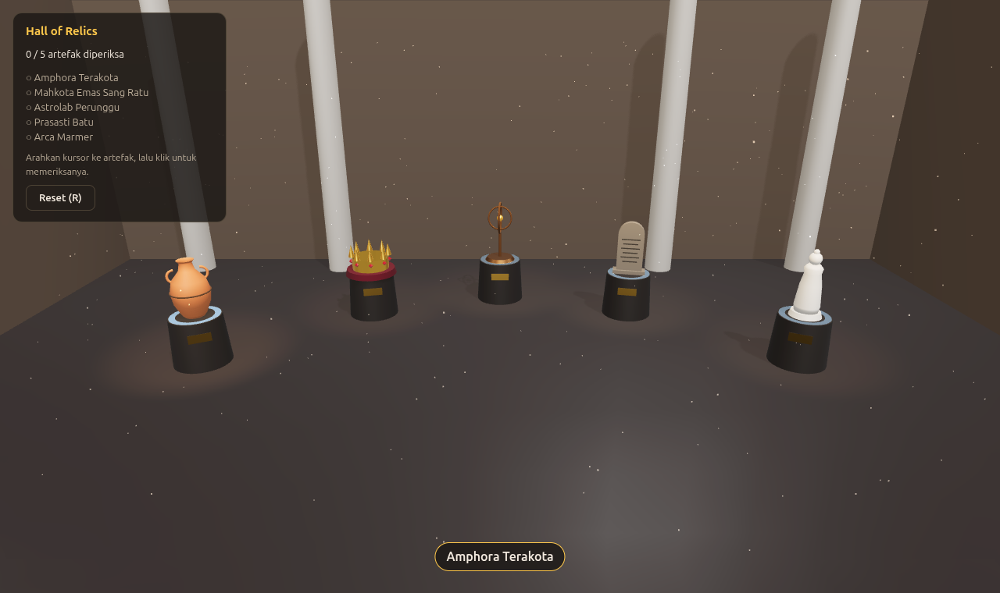

# Hall of Relics — Museum Artefak Kuno

UTS Grafika Komputer (EF234504) · Three.js Interactive 3D Project · **Topik 3: Interactive Museum**



## Anggota

**Kelompok:** _(nama/nomor kelompok)_

| Nama | NRP |
| --- | --- |
| Frenaldy Bestabba Hasugian | 5025241156 |
| Himawan Rakha Bhadra | _(NRP menyusul)_ |

## Deskripsi

Museum virtual berisi lima artefak kuno di atas pedestal bercahaya. Pengunjung menjelajahi aula,
menyorot artefak dengan kursor, lalu mengkliknya untuk memeriksa dari dekat. Saat diperiksa,
kamera terbang mendekat dan berputar pelan, dan panel informasi menampilkan cerita artefak beserta
sifat material PBR-nya. Pengunjung bisa mengubah roughness artefak secara langsung. Setelah kelima
artefak diperiksa, pameran selesai (**Exhibition Complete**).

Jenis project: **Interactive 3D Application** (tanpa menang/kalah, memakai completion state).

> Catatan: spesifikasi detail Topik 3 (`UTS_Threejs_Spesifikasi_03_Interactive_Museum.md`) tidak
> tersedia bagi kami. Project ini disusun dari slide UTS (deskripsi Topik 3 dan syarat umum slide 14–32).

## Alur interaksi (slide 45)

```
START (layar intro, tombol "Masuk Museum")
  ↓
EXPLORE — kamera overview, drag untuk orbit, scroll untuk zoom
  ↓
HOVER   — artefak disorot (spotlight 2×, glow emissive, label nama)
  ↓
SELECT  — klik → kamera terbang mendekat (INSPECT)
  ↓
INSPECT — kamera berputar otomatis, panel info, slider roughness
  ↓      (pemeriksaan pertama: percikan partikel emas)
BACK    — Esc / tombol Kembali → kembali ke overview; checklist tercentang
  ↓
PROGRESS "n / 5 artefak diperiksa"
  ↓
COMPLETION — 5/5 → overlay "Exhibition Complete" + ledakan confetti
  ↓
RESET   — tombol "Jelajahi Lagi" / R → kembali ke layar intro
```

## Kontrol

| Input | Fungsi |
| --- | --- |
| Gerakkan kursor | Sorot artefak (hover) |
| Klik kiri | Periksa artefak (inspect) |
| Drag kiri | Orbit kamera (drag tidak ikut memilih artefak) |
| Scroll | Zoom |
| Slider di panel | Ubah roughness artefak yang sedang diperiksa |
| `Esc` / tombol Kembali | Keluar dari mode inspect |
| `R` / tombol Reset | Kembali ke kondisi awal |

## Fitur grafika (slide 53)

| Fitur | Implementasi | File |
| --- | --- | --- |
| **Scene graph** | Tiap exhibit adalah `Group` { pedestal, plakat, spotlight, hit area, artefak }. Cincin dalam astrolab adalah *child* cincin luar, jadi gerakannya gabungan rotasi parent dan rotasinya sendiri | `exhibits.js`, `build-artifacts.mjs` |
| **Transform** | Posisi, rotasi (`lookAt` ke pengunjung), dan scale tiap exhibit | `exhibits.js` |
| **GLB** | Kelima artefak dimuat dari `public/models/artifacts.glb` dengan `GLTFLoader` dan indikator persen loading | `exhibits.js` |
| **PBR** | `MeshStandardMaterial` dengan roughness 0,25 (emas) sampai 0,95 (batu), metalness 0 sampai 1. Slider roughness memperlihatkan pengaruhnya secara langsung | `build-artifacts.mjs`, `exhibits.js` |
| **Lighting** | `HemisphereLight` + `DirectionalLight` (skylight) + 5 `SpotLight` (satu per exhibit, menguat saat hover) | `scene.js`, `exhibits.js` |
| **Shadow** | Skylight satu-satunya penghasil shadow (2048², PCF); artefak, pedestal, dan pilar `castShadow`; lantai, dinding, pedestal `receiveShadow` | `scene.js` |
| **Environment** | `RoomEnvironment` + `PMREMGenerator` sebagai environment map (pantulan pada logam), ditambah `Fog` | `scene.js` |
| **Animation** | (1) clip GLB `AstrolabeSpin` via `AnimationMixer`; (2) kamera terbang dengan easing; (3) turntable `autoRotate` saat inspect; (4) halo berdenyut; (5) partikel | `museum.js`, `effects.js` |
| **Raycasting** | `THREE.Raycaster` untuk hover dan klik, diuji ke hit area tak terlihat per artefak | `interaction.js` |
| **VFX** | Debu melayang (`Points`), halo cincin additive, percikan emas saat pemeriksaan pertama, confetti saat selesai | `effects.js` |

Syarat minimum UTS dan pemenuhannya:

| Syarat (slide) | Minimum | Di project ini |
| --- | --- | --- |
| Jenis object (14) | 3 | artefak (5 jenis), pedestal, plakat, pilar, dinding |
| Hierarchy (15) | 1 | 5 exhibit group + gimbal bersarang astrolab |
| GLB (16) | 1 | 1 file berisi 5 artefak + 1 clip animasi |
| Light (18) | ambient + 1 | hemisphere + directional + 5 spot |
| Shadow (19) | 1 cast + 1 receive | banyak |
| Animation (21) | 2 jenis | 5 jenis |
| Interaction (22) | 3, satu Raycaster | hover, klik/inspect, orbit, slider, kembali, reset |
| VFX (25) | 2 | 4 |

## Struktur project

```
ets/
├── index.html                  canvas + seluruh elemen HUD dan overlay
├── package.json                three@0.182.0, vite; script build:models
├── scripts/
│   └── build-artifacts.mjs     pembuat GLB: artefak disusun dari kode lalu diekspor
├── public/models/
│   └── artifacts.glb           hasil script di atas
├── screenshots/
└── src/
    ├── main.js                 entry point: menyambung semua modul + animation loop (THREE.Clock)
    ├── scene.js                renderer, kamera, OrbitControls, aula, lighting, environment, shadow
    ├── exhibits.js             data artefak, pemuat GLB, pembuat exhibit, highlight, roughness
    ├── museum.js               state machine (intro/explore/inspect/complete) + kamera terbang
    ├── interaction.js          raycasting hover/klik, pembeda klik vs drag, keyboard
    ├── effects.js              VFX: debu, halo, percikan, confetti
    ├── ui.js                   HUD, panel info, overlay (DOM)
    └── style.css
```

### Urutan membaca kode untuk belajar

Setiap function punya komentar dokumentasi (JSDoc) yang menjelaskan **apa** yang dilakukan dan
**kenapa** dibuat begitu. Urutan yang disarankan:

1. **`main.js`** — gambaran besar: modul apa saja dan bagaimana disambung.
2. **`scene.js`** — fondasi Three.js: renderer, kamera, cahaya, shadow, environment.
3. **`scripts/build-artifacts.mjs`** — bagaimana artefak dibuat dari geometri dasar, dan cara membuat clip animasi.
4. **`exhibits.js`** — scene graph exhibit, memuat GLB, material per artefak.
5. **`interaction.js`** — raycasting dan NDC.
6. **`museum.js`** — state machine dan animasi kamera.
7. **`effects.js`** — partikel dan additive blending.
8. **`ui.js`** — menghubungkan state ke HTML.

## Cara menjalankan

Butuh Node.js 20.19+ atau 22.12+ (syarat Vite 8).

```bash
npm install
npm run dev
```

Buka alamat yang dicetak Vite (biasanya <http://localhost:5173>).

| Perintah | Kegunaan |
| --- | --- |
| `npm run dev` | Server development |
| `npm run build:models` | Membuat ulang `public/models/artifacts.glb` dari kode |
| `npm run build` | Build produksi ke `dist/` |
| `npm run preview` | Menjalankan hasil build |

## Asset Credits

| Asset | Pembuat | Sumber | Lisensi |
| --- | --- | --- | --- |
| Lima artefak (`artifacts.glb`) dan clip animasinya | Kelompok sendiri | Dibuat dari kode, `scripts/build-artifacts.mjs` | Karya sendiri |
| Aula, pedestal, plakat, pilar | Kelompok sendiri | Geometri Three.js di `scene.js`, `exhibits.js` | Karya sendiri |
| Environment map | three.js authors | `RoomEnvironment` (addon resmi three.js, dibuat dari kode, tanpa file HDRI) | MIT |
| Library | three.js authors | <https://threejs.org> (`three@0.182.0`, termasuk `GLTFLoader`, `GLTFExporter`, `OrbitControls`) | MIT |

Tidak ada model, texture, HDRI, suara, ikon, atau font yang diunduh dari luar.

## Challenge dan keputusan teknis

- **Three.js dipin ke r182.** Mulai r183, `THREE.Clock` mencetak peringatan deprecation di Console.
  r182 adalah versi terakhir yang memenuhi "Clock + Console bersih".
- **`PCFShadowMap`, bukan `PCFSoftShadowMap`.** Tipe soft sudah deprecated di r182 dan juga mencetak peringatan.
- **Hanya satu lampu yang menghasilkan shadow.** Lima spotlight dengan shadow berarti lima render
  pass tambahan per frame. Skylight tunggal (2048²) cukup untuk seluruh aula (performance awareness, slide 32).
- **Hit area tak terlihat untuk raycasting.** Astrolab terdiri dari dua cincin berputar dengan
  celah besar, sehingga ray sering lewat menembus celah dan klik "meleset". Raycasting diarahkan ke
  kotak tak terlihat seukuran artefak: selalu mudah diklik dan jauh lebih murah (5 kotak, bukan
  ribuan segitiga).
- **Klik dibedakan dari drag.** Setelah drag kamera, browser tetap mengirim event `click`. Tekanan
  yang bergerak lebih dari 5 piksel dianggap drag, sehingga tidak memilih artefak.
- **Material di-clone per artefak.** Supaya highlight dan slider roughness hanya mengubah artefak
  yang bersangkutan.

## Pembagian kontribusi

| Anggota | Bagian | Konsep yang dijelaskan di video |
| --- | --- | --- |
| Frenaldy | `interaction.js`, `museum.js`, `effects.js`, `ui.js` | raycasting, alur interaksi, kamera fokus, animasi, VFX, HUD, completion |
| Himawan | `scene.js`, `exhibits.js`, `scripts/build-artifacts.mjs` | scene graph, PBR, lighting, shadow, GLB, environment map |

## Checklist akhir (slide 61)

- [x] Project berjalan (`npm install` + `npm run dev`)
- [x] Asset tidak missing (GLB dimuat, ada pesan jelas bila gagal)
- [x] Console tanpa error dan warning
- [x] Interaction bekerja (hover, klik, orbit, slider, Esc, reset)
- [x] Objective jelas (checklist 5 artefak di HUD)
- [x] Completion bekerja (5/5 → overlay + confetti)
- [x] Shadow terlihat
- [x] VFX bekerja
- [x] README lengkap
- [x] Credits lengkap

## Catatan debugging dan pengujian

Diuji di Chromium dengan mouse asli (bukan event buatan):

- Alur penuh: kelima artefak dibuka, progres naik 1/5 sampai 5/5, overlay completion muncul,
  reset kembali ke layar intro dengan 0/5. Console: 0 error, 0 warning.
- Slider roughness mahkota 0,25 → 1,0 mengubah emas dari mengkilap (memantulkan ruangan) menjadi
  kuning datar; setelah `Esc` dan dibuka lagi, nilainya kembali ke 0,25.
- Drag kamera tidak membuka artefak.
- Resize ke 480×820: drawing buffer ikut 480×820, objek tidak gepeng, kelima pedestal tetap masuk layar.
- `npm run build` berhasil. Peringatan ukuran chunk (±635 kB) berasal dari library three.js, bukan error.

Bug yang ditemukan dan diperbaiki saat pengujian:

1. **Astrolab tidak bisa diklik** di beberapa sudut karena ray menembus celah cincin → diganti hit area.
2. **Pita hitam di atas layar** karena kamera overview berada tepat di ketinggian langit-langit
   (bidangnya terlihat dari samping, setebal nol) → aula dinaikkan ke 7 m.
3. **Kamera intro "tertarik"** ke `maxDistance` OrbitControls → `controls.update()` tidak dipanggil di layar intro.
4. **Artefak tepi terpotong di layar potret** → FOV vertikal diperlebar saat aspect < 1.
5. **`Esc` diabaikan selama kamera masih terbang** (±1,2 detik setelah klik) → `back()` kini boleh
   dipanggil kapan saja dalam mode inspect; penerbangan langsung berbalik ke overview.

Kasus tepi yang juga sudah diuji: memeriksa artefak yang sama dua kali tidak dihitung ganda, reset
di tengah inspect memulihkan roughness, dua putaran completion berturut-turut, dan resize saat inspect.
